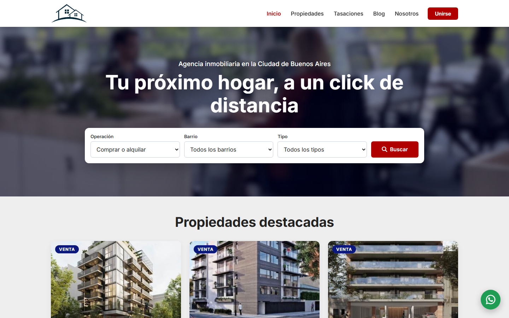

# Viviendas UB – Sitio inmobiliario Full Stack (PHP + MySQL)

Proyecto de Prácticas de Laboratorio – Tecnicatura en Programación de Computadoras (Universidad de Belgrano).

Sitio web de una inmobiliaria con un **sitio público** para buscar propiedades y contactar a la empresa, y un
**panel de administración** para gestionar propiedades, noticias, personal y las consultas que llegan desde el sitio.



## Funcionalidades

**Sitio público**
- Inicio con carrusel, buscador por barrio y tipo, propiedades destacadas, servicios y últimas noticias.
- Listado de propiedades con filtros, orden por precio y botón **"Cargar más"** (8 por carga, desde una API JSON). Al ordenar por precio, los precios en dólares se comparan en pesos con la cotización del dólar blue ([dolarapi.com](https://dolarapi.com), se actualiza cada hora y tiene un valor de respaldo en `config.php`); en pantalla cada precio se sigue mostrando en su moneda.
- Ficha de cada propiedad con galería, características y formulario de consulta al agente asignado.
- Solicitud de tasación, postulación para sumarse al equipo y formulario de contacto.
- Blog con las últimas noticias en un carrusel y el resto en una grilla con **"Cargar más"** (12 por carga, desde una API JSON). Cada artículo muestra fecha, autor y tiempo de lectura.
- Nosotros, Preguntas frecuentes, Política de privacidad y Términos (con índice lateral).
- Botón flotante de WhatsApp y diseño adaptable a celular. Los enlaces de WhatsApp abren con un mensaje sugerido según la sección o la propiedad desde la que se escribe.
- Los emails se copian con un clic en lugar de abrir el programa de correo (`mailto:`), que no funciona si el navegador no tiene uno configurado.

**Panel de administración** (`/admin/`)
- Inicio con tarjetas de resumen que abren cada lista filtrada por lo nuevo.
- Consultas, tasaciones y postulaciones con buscador, pestañas por estado y cambio de estado.
- Alta, modificación y baja de propiedades (con varias imágenes) y de noticias.
- Alta y modificación del personal, activación/desactivación y asignación de rol.

## Stack

| Capa | Tecnología |
|---|---|
| Frontend | HTML5, CSS3 (variables), JavaScript, Swiper, Font Awesome |
| Backend | PHP 8.x (PDO, sesiones, `password_hash`) |
| Base de datos | MariaDB 10.11 (InnoDB, claves foráneas, transacciones) |
| Tests | Jest + jsdom (cliente) y script PHP sin dependencias (servidor) |
| Entorno | Docker Compose (PHP 8.3 con Apache, MariaDB 10.11 y Adminer) |

## Cómo levantarlo

El proyecto se levanta **solo con Docker**: no hace falta instalar PHP ni MySQL. Otras formas (por ejemplo, un PHP
instalado en el equipo) no están soportadas: sin las variables de entorno de `docker-compose.yml` el sitio no arranca.

Requisito: [Docker Desktop](https://www.docker.com/products/docker-desktop/).

```bash
# 1. Levantar la base y el servidor web (la primera vez construye la imagen y carga la base)
docker compose up -d --build

# 2. Crear el administrador (clave: 8+ caracteres con letras y números)
docker compose exec web php database/crear_usuario.php "Nombre" "Apellido" admin@viviendasub.com "Clave2026" ADMIN

# 3. (Opcional) Cargar datos de demostración: consultas, tasaciones y postulaciones en todos los estados
docker compose exec db sh -c "mariadb -uroot -proot --default-character-set=utf8mb4 < /sql/04_datos_demo.sql"
```

| Qué | URL |
|---|---|
| Sitio público | http://localhost:8080/ |
| Panel | http://localhost:8080/admin/ |
| Visor de la base (Adminer) | http://localhost:8081/ |

**Ver la base de datos:** en http://localhost:8081/ ingresar con Sistema **MySQL**, Servidor **db**, Usuario
**viviendas**, Contraseña **viviendas** y Base de datos **viviendas_ub**. Se ven las 9 tablas con sus datos y la
estructura; "Esquema de base de datos" muestra el diagrama de relaciones. Sirve para comprobar que lo que se
agrega, modifica o da de baja desde el sitio o el panel queda guardado (recargar la tabla con F5). Usa un tema con
los colores del proyecto (`docker/adminer/adminer.css`) y el diagrama se abre ordenado según las relaciones
(`docker/adminer/esquema.php`); las tablas del diagrama se pueden arrastrar.

La base se crea sola con `01_schema.sql`, `02_datos_iniciales.sql` y `03_noticias_contenido.sql` la primera vez.
No hay que configurar nada: `config/config.php` toma los datos de conexión de las variables de entorno que define
`docker-compose.yml`.

**Qué trae la base inicial**

| Tabla | Registros | Detalle |
|---|---|---|
| `roles` | 2 | ADMIN y VENDEDOR |
| `tipos_propiedad` | 6 | Departamento, Casa, PH, Terreno, Oficina, Local comercial |
| `usuarios` | 10 | Los agentes de Nosotros, **sin clave**: no pueden entrar al panel hasta que el administrador les asigne una |
| `propiedades` / `propiedad_imagenes` | 12 / 12 | 9 en venta (USD) y 3 en alquiler (ARS), con una portada cada una |
| `noticias` | 18 | Los 4 artículos del blog anterior y 14 más firmadas por agentes, para que el blog muestre la grilla y "Cargar más" |
| `consultas`, `solicitudes_tasacion`, `postulaciones` | 0 | Se llenan desde los formularios (o con los datos de demostración del paso 3) |

No hay ningún administrador hasta que se ejecuta el paso 2.

**Datos de contacto y cotización** (`config/config.php`, sección `empresa` y `cotizacion`): email de la empresa,
los dos teléfonos del pie, el número del botón flotante de WhatsApp y la URL y el valor de respaldo de la cotización
del dólar. El teléfono de cada agente se edita desde el panel (Personal).

Comandos útiles:

```bash
docker compose stop              # apagar (los datos se conservan)
docker compose start             # volver a encender
docker compose logs -f web       # ver errores de PHP/Apache
docker compose down -v           # borrar todo, incluida la base (al volver a levantar se recrea desde cero)
```

Si los puertos 8080, 8081 o 3308 están ocupados, se pueden cambiar al levantar:
`WEB_PUERTO=8090 ADMINER_PUERTO=8091 DB_PUERTO=3309 docker compose up -d` (en PowerShell: `$env:WEB_PUERTO=8090; docker compose up -d`).
El puerto de la base (por defecto `127.0.0.1:3308`, usuario `viviendas` / clave `viviendas`) sirve para conectarse
con DBeaver o MySQL Workbench.

### Probar el rol Vendedor

Panel → Personal → editar un agente → asignarle una clave → cerrar sesión e ingresar con ese agente.
Debe ver solo sus propiedades y consultas, sin los menús Noticias ni Personal.

## Roles

| Funcionalidad | ADMIN | VENDEDOR |
|---|---|---|
| ABM propiedades | Todas | Solo propias |
| Consultas por propiedad | Todas | Solo asignadas |
| Solicitudes de tasación / postulaciones | Sí | No |
| ABM noticias | Sí | No |
| ABM personal (usuarios) | Sí | No |

## Seguridad

- Consultas SQL siempre preparadas (PDO) e integridad referencial con claves foráneas.
- Claves con `password_hash`; la sesión se valida contra la base en cada pedido (un usuario desactivado pierde el acceso al instante).
- Token CSRF en todos los formularios y campo trampa (honeypot) contra envíos automáticos.
- Validación de datos en el cliente y en el servidor; salida escapada contra XSS.
- Imágenes validadas por contenido real (no por extensión), con nombre aleatorio y sin ejecución de scripts en `uploads/`.
- `.htaccess` que bloquea el acceso por URL a `config/`, `includes/`, `database/`, `tests/` y `docker/`.

## Tests

Las pruebas de JavaScript necesitan [Node.js](https://nodejs.org/) 18 o superior; las de PHP corren dentro del contenedor.

```bash
npm install
npm test                                              # Jest: 40 tests
docker compose exec web php tests/php/validador_test.php   # PHP: 15 OK
```

## Estructura

```
admin/          Panel de administración (login, consultas, ABM de propiedades, noticias y personal)
api/            Endpoints JSON para "Cargar más" propiedades y noticias
config/         Configuración del sitio (la conexión a la base llega por variables de entorno de Docker)
css/            Variables de diseño, estilos del sitio y del panel
database/       Scripts SQL (esquema, datos iniciales, noticias, demo) y alta de usuarios por CLI
doc/            Documentación del proyecto y evidencias de pruebas
docker/         Imagen de PHP/Apache, carga de la base y tema del visor Adminer para Docker
imagenes/       Imágenes fijas del sitio
includes/       Conexión, autenticación, validaciones, repositorio de datos y plantillas comunes
js/             Validaciones, "Cargar más", copiar email, panel y comportamiento general
tests/          Pruebas Jest (cliente) y PHP (servidor)
uploads/        Imágenes subidas desde el panel (no se versionan)
*.php           Páginas del sitio público
```

## Documentación

| Documento | Contenido |
|---|---|
| [doc/casosDeUso.docx](doc/casosDeUso.docx) | Casos de uso y diagrama |
| [doc/diagramasDeFlujo.docx](doc/diagramasDeFlujo.docx) | Diagramas de flujo de los procesos principales |
| [doc/modeloDeDatos.docx](doc/modeloDeDatos.docx) | Modelo de datos y diccionario de tablas |
| [doc/casosDePrueba.docx](doc/casosDePrueba.docx) | Casos de prueba y resultados |
| [doc/04_casos_de_prueba.md](doc/04_casos_de_prueba.md) | Resultados de ejecución con enlaces a las [evidencias](doc/evidencias/) |
| [doc/manualDeUsuario.docx](doc/manualDeUsuario.docx) | Manual de usuario del sitio y del panel |
## Problemas frecuentes

| Síntoma | Causa / solución |
|---|---|
| "Falta la variable de entorno DB_HOST" | Se abrió el sitio sin Docker. Levantarlo con `docker compose up -d --build`. |
| "Error de conexión a la base de datos" | La base todavía arranca o está apagada: `docker compose ps` y `docker compose logs db`. |
| Acentos como `ó` | Un `.sql` se cargó a mano sin UTF-8: repetir con `--default-character-set=utf8mb4`. |
| Docker: "port is already allocated" | Cambiar `WEB_PUERTO`, `ADMINER_PUERTO` o `DB_PUERTO` (ver Cómo levantarlo). |
| Adminer no muestra un cambio recién hecho | Recargar la página (F5). En la lista de tablas, la columna "Registros" es aproximada (`~`): para el número exacto, abrir la tabla. |
| Docker: la base no tiene los cambios de los `.sql` | Los scripts solo corren con la base vacía: `docker compose down -v` y volver a levantar. |
